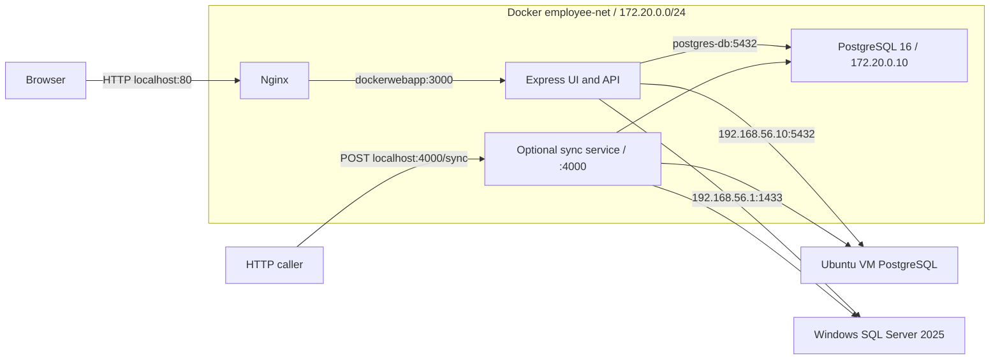

# Containerized Employee Directory and Database Sync POC

This POC demonstrates a Dockerized Node.js/Express employee directory behind Nginx with CRUD access to PostgreSQL in Docker, PostgreSQL on an Ubuntu Hyper-V VM, and native SQL Server 2025 on Windows. Manual sync copies the selected node's full employee table to the other nodes and reseeds IDs. The web app uses the VM as the intermediate dataset hop for container-to-SQL and SQL-to-container copies.

## Architecture



Nginx proxies every web path to Express and forwards host, client IP, and protocol headers. Express renders HTML and implements CRUD/search and sync. Container PostgreSQL persists data in a named volume; external databases stay on the VM and host. Node.js holds the connections and copies rows between databases. The optional standalone service exposes its own sync endpoint; the UI does not call it.

## Tech stack

Node.js 20 Alpine, Express `^4.19.2`, PostgreSQL client `pg ^8.11.5`, SQL client `mssql ^10.0.2`, `nginx:alpine`, container PostgreSQL 16, VM PostgreSQL, native SQL Server 2025, Docker Compose, and Windows Hyper-V. The UI uses server-rendered HTML, inline CSS, and browser JavaScript.

## Project structure

```text
.
|-- docker-compose.yml
|-- .env.example
|-- .gitignore
|-- README.md
|-- KNOWN_ISSUES.md
|-- db/
|   |-- postgres/001-employees.sql
|   '-- sql-server/001-employees.sql
|-- dockerwebapp/
|   |-- .dockerignore
|   |-- Dockerfile
|   |-- package.json
|   |-- server.js
|   |-- dockerwebapp-backend.tar
|   '-- postgres16.tar
|-- nginx-proxy/
|   |-- .dockerignore
|   |-- Dockerfile
|   '-- nginx.conf
'-- sync-service/
    |-- .dockerignore
    |-- Dockerfile
    |-- package.json
    '-- sync-service.js
```

TAR archives remain on disk and are excluded from Git and build contexts. Compose builds the current source.

## Prerequisites

- Docker Desktop with Linux containers and Docker Compose.
- Ubuntu Hyper-V VM on internal switch `POC-Internal-Switch`: host adapter `192.168.56.1`, VM `192.168.56.10`, and routing from Docker Desktop to both addresses.
- VM PostgreSQL accepting TCP 5432, with listening address, client authentication, and firewall access configured for the application.
- Native SQL Server 2025 with SQL authentication, TCP/IP on port 1433, and host firewall access for the application.
- External accounts with CRUD and overwrite/reseed permissions, including PostgreSQL truncation/sequence operations and SQL identity insertion/`DBCC CHECKIDENT`. Initialize PostgreSQL as the database owner; use `dbo` as the SQL application's default schema.
- `psql` on Ubuntu and `sqlcmd` on Windows for initialization.
- Available host ports 80 and optionally 4000, and Docker subnet `172.20.0.0/24`.

## Configuration

Compose reads root `.env` and injects database settings into both Node services. Copy `.env.example` and replace **every placeholder** before starting. Passwords have no defaults and are required by Compose. Both Node processes require all 12 DB settings (host, user, password, and name for each node) and exit with an error listing missing or blank variables before opening database connections. Compose supplies the non-secret defaults below; direct Node runs must supply them explicitly.

| Variable | Compose default when omitted |
| --- | --- |
| `CONTAINER_DB_USER` | `admin` |
| `CONTAINER_DB_PASSWORD` | Required; no default |
| `CONTAINER_DB_NAME` | `employeesdb` |
| `VM_DB_HOST` | `192.168.56.10` |
| `VM_DB_USER` | `admin` |
| `VM_DB_PASSWORD` | Required; no default |
| `VM_DB_NAME` | `employeesdb` |
| `SQL_DB_HOST` | `192.168.56.1` |
| `SQL_DB_USER` | `docker_user` |
| `SQL_DB_PASSWORD` | Required; no default |
| `SQL_DB_NAME` | `employeesdb` |

Compose sets `CONTAINER_DB_HOST=postgres-db`. Direct Node runs must set it to a reachable database address. Container user/password/database settings initialize PostgreSQL and configure both services consistently.

| Component | Port/address |
| --- | --- |
| Nginx | Host 80 → container 80 |
| Express | Internal 3000 |
| Container PostgreSQL | Internal `postgres-db:5432`, static `172.20.0.10` |
| VM PostgreSQL | `192.168.56.10:5432` |
| SQL Server | `192.168.56.1:1433` |
| Optional sync | Host 4000 → container 4000 |

Node listener/PostgreSQL client ports are fixed in source; SQL uses the driver's default 1433. External host addresses are configurable.

## Setup and run

### 1. Configure environment

From the project root in PowerShell:

```powershell
Copy-Item .env.example .env
```

Edit every placeholder: choose container credentials, match external accounts, set VM/SQL hosts to `192.168.56.10`/`192.168.56.1`, and use `employeesdb` for database names unless customizing them.

### 2. Initialize external databases

On Ubuntu, create the configured PostgreSQL role and database. Copy `db/postgres/001-employees.sql` to the VM and run as database owner; this example uses default names:

```bash
psql -h 127.0.0.1 -U admin -d employeesdb -W -v ON_ERROR_STOP=1 -f /path/to/001-employees.sql
```

On Windows, from project root, use a SQL administrator account:

```powershell
sqlcmd -S 192.168.56.1,1433 -E -b -i ./db/sql-server/001-employees.sql -v DatabaseName="employeesdb"
```

`-E` uses Windows authentication. Replace the database name with `SQL_DB_NAME` if customized. Separately create/map the SQL login in `.env` and grant the required permissions. DDL does not create logins or store secrets. Configure external listeners, authentication, routing, and firewall rules before startup.

Both scripts define integer IDs, name/address `VARCHAR(255)`, phone `VARCHAR(50)`, and salary precision 10, scale 2. PostgreSQL uses owned sequence `public.employees_id_seq`; SQL Server uses `IDENTITY(1,1)`.

### 3. Start the web stack

From the project root:

```powershell
docker compose config --quiet
docker compose up -d --build
docker compose ps
```

Compose starts PostgreSQL, waits for its readiness check, then starts Express and Nginx. The container initializes its schema automatically for a new volume. Open **http://localhost/** and select `/`, `/vm`, or `/sql`.

Include the separate sync service with:

```powershell
docker compose --profile sync up -d --build
```

### 4. Use and manage the stack

Add, search, edit, or delete employees on the selected tab. Press **Sync** to copy that node's entire table; search filters do not restrict sync. Read [KNOWN_ISSUES.md](KNOWN_ISSUES.md) before reconciling valuable data.

```powershell
docker compose logs --tail 100 dockerwebapp nginx-proxy postgres-db
docker compose --profile sync logs --tail 100 sync-service
docker compose --profile sync down
```

`down` retains the database volume. Initialization scripts and changed PostgreSQL initialization credentials apply only to a new volume; manage existing databases explicitly.

## HTTP endpoints

CRUD returns HTML or redirects. Insert/update accept `name`, `phone_number`, `address`, and `salary`; update/delete also need `id`. Forms send URL-encoded bodies; Express also parses JSON.

| Method | Paths | Purpose |
| --- | --- | --- |
| GET | `/`, `/vm`, `/sql` | List employees |
| GET | `/search`, `/vm/search`, `/sql/search` | Search with `field` and `value` |
| POST | `/insert`, `/vm/insert`, `/sql/insert` | Insert with `MAX(id) + 1` |
| POST | `/update`, `/vm/update`, `/sql/update` | Update by ID |
| POST | `/delete`, `/vm/delete`, `/sql/delete` | Delete, compact IDs, reseed |
| POST | `/api/sync` | Web app VM-mediated sync |
| POST | `http://localhost:4000/sync` | Optional standalone sync |

Search permits `id`, `name`, `phone_number`, `address`, and `salary`; PostgreSQL uses text casting/`ILIKE`, SQL uses `CAST(... AS VARCHAR) LIKE`.

Sync examples:

```powershell
Invoke-RestMethod -Method Post -Uri http://localhost/api/sync -ContentType 'application/json' -Body '{"source":"container"}'
Invoke-RestMethod -Method Post -Uri http://localhost:4000/sync -ContentType 'application/json' -Body '{"source":"vm"}'
```

## How sync works

### Web app

1. Browser posts selected source `container`, `vm`, or `sql` to `/api/sync`.
2. Express validates the source (HTTP 400) and rejects overlapping sync requests in the same process (HTTP 409).
3. It reads five employee columns ordered by ID and follows this copy path:

| Source | Ordered path |
| --- | --- |
| Container | Read container → overwrite VM → re-read VM → overwrite SQL |
| VM | Read VM → overwrite container → overwrite SQL |
| SQL | Read SQL → overwrite VM → re-read VM → overwrite container |

4. Each PostgreSQL target gets a transaction: truncate, insert explicit IDs, then set `employees_id_seq` to the maximum ID. Empty data sets the next generated ID to 1.
5. Each SQL target gets a transaction: delete all rows, insert source IDs using `IDENTITY_INSERT`, then reseed to the maximum ID, or 0 for empty data.
6. Targets commit separately. Success returns `{success: true, message}` with processed count in the message; failure returns HTTP 500 with `{success: false, message}`. UI reloads on success.

### Standalone service

`sync-service.js` reads once and copies directly to both targets: container → VM then SQL; VM → container then SQL; SQL → container then VM. It uses full-table overwrite/reseeding, without VM re-reading or the web guard. Empty PostgreSQL data restarts the sequence at 1.

It connects to SQL before source validation. Success returns `{success, count, message}`; invalid-source/failure responses use `{success: false, error}` and HTTP 400/500. Nginx does not proxy this endpoint.

## Design decisions

Manual sync makes source selection explicit and separates reconciliation from CRUD. Docker manages the local database and web components while the VM and native SQL Server remain external.

## Design history

The project began with PostgreSQL streaming replication, then moved to bidirectional logical replication. Race conditions and ID collisions led to odd/even sequence partitioning before the project settled on on-demand manual sync. These are historical stages; the current implementation uses manual sync, not replication or odd/even sequences.

## Troubleshooting

| Symptom | Check |
| --- | --- |
| Port cannot bind | Host listeners on 80 or optional 4000 |
| Network creation fails | Existing employee-net or subnet overlap |
| Container authentication fails | .env and credentials used to initialize the volume |
| Nginx cannot reach app | Compose status/logs; upstream dockerwebapp:3000 |
| VM connection fails | Switch, addresses, Docker routing, listener/authentication/firewall on 5432 |
| SQL connection fails | Host, TCP 1433, firewall, login/database mapping and permissions |
| Missing table/sequence | Apply DDL to selected database; container init runs only on new volumes |
| Sync returns 409 | Wait for the active web sync |
| Partial sync, duplicate keys, salary overflow | See KNOWN_ISSUES.md |

See [KNOWN_ISSUES.md](KNOWN_ISSUES.md) for risks, limitations, and deployment trade-offs.
